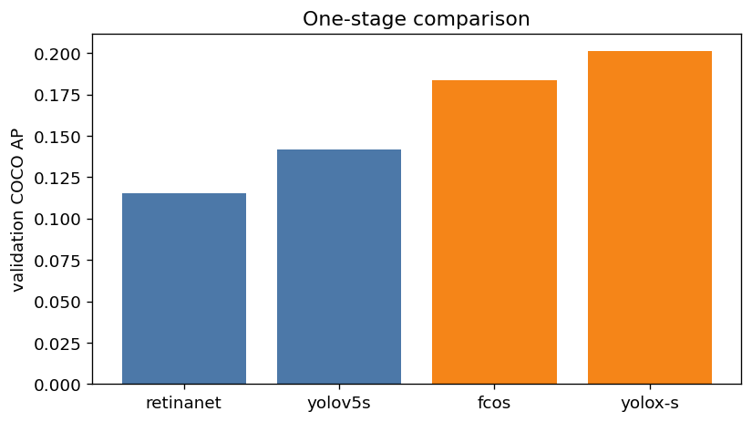
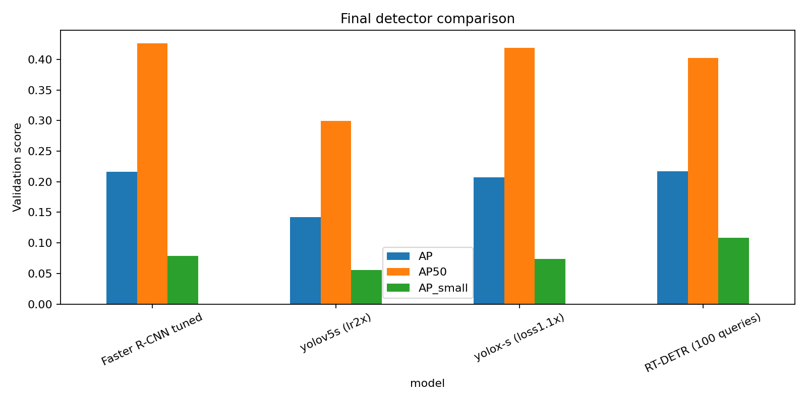
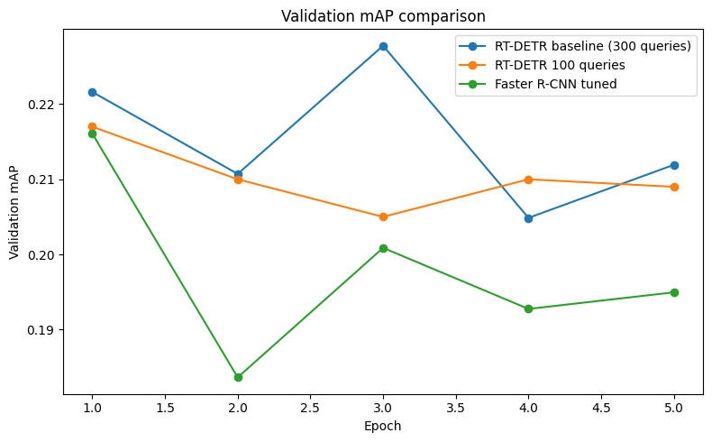
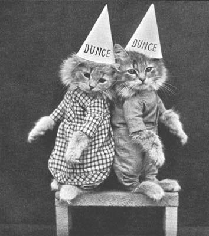

## Introduction
>Authors: Iia Maharyta and Vladyslav Danylyshyn

In this homework we practiced with videodetection from dron. There were 8 classes: person, bicycle, car, van, truck, tricycle, bus, motor.

Given train dataset is built from 56 videos -- which is 24 201 frame, and validation is 7 videos (2 846 frames). There are also *ignore* files -- zones which are not taken for training the model.

### Structure
- One stage detector investigation and main run are at [one-stage-400](notebooks/one_stage-400.ipynb) and [one-stage](notebooks/one_stage.ipynb)
- Two stage detector is at [two-staged](notebooks/two-staged-model.ipynb)
- Query-based models are at [query-based](notebooks/query_based.ipynb)
- Our pipeline is evaluated at [homework](notebooks/homework.ipynb)

## Methodology

### Data preparation
 > problems are highlighted with **bold** for better visual understanding :+)

1. Find and analyse the class disbalance.

An example from dataset:
| Class    | Train %  |Val % |
|----------|----------|------|
| Car | 45.7 | 27.9 |
| Person   | 29.7 | 44.1 |
| Bus | <1 | 0.2 |

The dataset is highly imbalanced, which would lead to **model strugling to identify any other class**, especially such classes, as bus.

But COCO AP gives us ability to work with AP of each class separatly, so we can see with which classes model works worse.
___
2. Classes in video distribution

Classes are differently distributed between videos and using a subset of videos for trainig/validation **won't represent the whole dataset**. Therefore we used whole train dataset.
___
3. Study bounding boxes sizes

Median size of bounding box is `44x48`, and about 25% of boxes are smaller than $32^2$. 

That leads to model **strugling with small objectes**, even more when reducing resolution.

Solution: used `1280x1280` letterbox, data augmentation with random scale `[0.5, 1.5]`, also used small AP metric to understand how model deals with small objects.
___
4. Amount of object per frame

| Dataset | Median | Max |
|----|----|----|
|Train | 43 | 180 |
| Val | 37 | 116 |

There are a lot of objects inside the frame, and model has to **detect all of them simultaneously**. It becames even harder when objects are small or cover each other.

Solution: 
- we did not use bounding boxes union;
- `iscrowd=1`, so model is less punished for "crowded" object when validating.
___
5. Inspect similarity of neighbouring frames

We used IoU (Intersection over Union) -- a metric that defines how much two bounding boxes are covered by aech other -- and recieved a median of 0.99 for neighbouring frames. That means that **neighbouring frames match up**, which causes longer traininig, many "duplicate" and unnecesary frames, and less divergent training dataset

We experimented with taking in account only each 5th frame and got IoU of 0.597, but for training we did NOT reduce dataset by 5. 
___
6. Different models expect different data format

For each model we built an unified pipeline:
- We transfered YOLO-format data into pixels
- performed augmentation
- corrected bounding boxes coordinates and cut those, that lay outside
- pass data to model

However, each model expects different data normalization:
| model | pixel normalization |
| --- | --- |
| Faster R-CNN | [0,1] |
| YOLOv5 | [0,1] |
| RT-DETR | ImageNet mean/std |
| YOLOX | [0, 255] |

And for that reason normalisation was performed for each model separately.
### Validation
First of all, we used train/val split with videos, not frames. Otherwise some frames from the same video would get a possibility to appear in both split parts, which would make validation unfair (data leakage, say Hi to Arsenii Stratiuk).
___
| Metric | Meaning |
|--------|---------|
| COCO AP | quality of detection when IoU is from 0.5 to 0.95 | 
| AP50 | quality of detection when IoU is 0.5 |
| AP_small | quality of detection of small objects |
| AP per class | quality of detection per each class separately | 

Checkpoint is chosen by best validation AP, not by last training epoch.

___
For Faster R-CNN and RT-DETR we also found frames where amount of objects is more than 100 and experimented how models behave in that situation.
___
We also measured inference speed for R-CNN and RT-DETR:
1. warmed up the model
2. evaluated time of processing of 100 frames

So we can compare models using differenc characteristics.
___
Different models have different training budgets.

**One-stage detectors** 
|stage | steps | images|
|---|---|---|
|investigation | 400 | 800|
| main run | 4000 | 8000 |

**Two-stage and RT-DETR**
> 5 epochs \
> 121 005 images

Why? It makes sense for us to compare models that train slower and faster, especially when they have close scores.

One-stage was trained in about 2 hours, while each epoch of two-staged/query-based takes about 1 hours -> ~5-6 hours in total. Though their val. AP/mAP does not differ a lot.

We still tried to train one-stage on whole dataset (train + val), which took way more time, but it did not end up improving score significantly, and gave us a score smaller than baseline. 

### Models
Here we explored 3 families of detectors, with pretrained COCO-weights.

We use transfer learning, which means that we don't have to train models from scratch. Instead we replace detection head -- part of the neural network that is responsible for final prediction.

In terms of basic architecture:
```
Backbone
|
Neck
|
Detection head
```
so here we train from scratch only the last one.
___
**1. Two-stage detector: Faster R-CNN**

This one has, unironically, two stages:
- Region Proposal Network -- network analyses image and proposes fields, where objects may be
- Classification + Bounding box regression: defining the object's class and cordinates of a box.

This one has 9 outputs -- 8 classes + background
___
**2. One-stage detectors**

Main difference from two-stage: there are no separate steps of generation+processing of region proposals; This model predicts classes and coordinates immediately.

We compare 4 models:
```text
RetinaNet
Anchor-based 

Focal Loss -> deals with disbalance between actual object and background.
```

```text
FCOS
Anchor-free 

Predicts objects according to feature map. Also uses center-ness -- 
"how close is a point to the object center?"
```

```text
YOLOv5s
Anchor-based 

Is more of a fast classical YOLO detector
```

```text
YOLOX-s
Anchor-free 

Head has different branches per each task: 
classification + regression + objectness; 
Also uses SimOTA -- algorithm for determining which predictions 
can be a positive examples for learning
```

What is the difference between anchor-based and anchor-free models?
| Anchor-based | Anchor-free|
|---|---|
| has predefined rectangles with different sizes - anchors | No pre-defined anchors |
| model learns to define if anchor corresponds to an object, how to adjust it's coordinates and how to predict class | predicts coordinates of a box according to features  |


**Nuances**
- Base learning rate is adjusted according to batch size 
- LR for head is 10x larger, because it starts from random weights
- We use NMS algorithm so only the best of similar bounding boxes are left
___
**3. Query-based: RT-DETR**

This family is based on object queries (vectors that take part in searching an object).

Significant feature is bipartite matching. It matches predictions with ground truth: each object is mathed with maximum one ground truth. That prevents duplicates. (analog of NMS)

We compared 100 query and 300 query models.

### Tuning
**1. Tuning Faster R-CNN**
```python
positive_fraction: 0.25 -> 0.5 
```
Positive RoI - some Region of Interest matches ground truth good enough; `positive_fraction` determines a maximum fraction of positive RoI among those RoI, that are chosen for one training batch.

**Why** did we increase it? Frames from dataset are pretty dense, therefore posibility of RoI including an object and being positive is higher. In that way classificator gets more positive examples.

```python
step_size: 4
gamma = 0.1
```
`step_size` decreases LR at each step (every 4th epoch in this case) by multiplying it with gamma. This is important, because at first model has to find good parameters quickly, and by the end smaller LR helps it to configure them properly. 
___
**2. Tuning RT-DETR**

The only parameter that was changed is amount of queries: from 300 to 100. Size of query embeddings are also changed, therefore we use `ignore_mismatched_sizes`.

**Why** did we do so? Maximum objects per frame is 180 (train) or 116 (val), so no need to have 300 queries. 100 queries means that model will detect no more than 100 objects, so this was a compomise between computational resourses and full detection.
___
**3. Tuning one-stage**

Here we experimented with 2 parameters:
```
learning rate
loss multiplier
```
We experimented with changing these parameters and found the most optimal ones.

## Results
### General
For benchmarking we used COCO AP on the same 7 validation videos.

Main validation results:
| Model        | budget | AP   | ms/frame |
|--------------|----------|------| ---|
| RT_DETR, 300        | 5 epochs    | 0.228 | 37 |
| RT_DETR, 100        | 5 epochs    | 0.217 | 35 |
| Faster R-CNN tuned  | 5 epochs    | 0.216 | 55 |
|Faster R-CNN baseline| 5 epochs    | 0.215 | 55 |
| YOLOX-s, loss ×1.1  | 8000 images | 0.207 | 89 |
| YOLOX-s baseline    | 8000 images | 0.201 | 86 |
| FCOS                | 8000 images | 0.183 | 110|
| YOLOv5s, lr ×2      | 8000 images | 0.142 | 73 |
| YOLOv5s baseline    | 8000 images | 0.142 | 72 |
| RetinaNet           | 8000 images | 0.115 | 127|



Car was the easy class on every model -- AP about 0.32-0.41. Bus was different: 0.014 for RetinaNet, 0.107 for YOLOX-s, 0.217 for tuned Faster R-CNN and for RT-DETR with 100 queries.
### Improvements
One-stage run with 4000 steps and 8000 images gave us a clear improvement comparing to the small run (400 steps, 800 images). YOLOv5s went from AP 0.058 to 0.142. YOLOX-s went from 0.130 to 0.201.

Tuning them with parameters also improved metrics.
### Other experiments
We also tested models (query-based and best two-stage) on dense frames.
There RT-DETR with 100 queries has dense AP 0.279, and tuned Faster R-CNN scored 0.238. So the smaller query set is weaker on the whole validation set and stronger on this crowded subset.

The other small test is horizontal flip. On the 100-query model it raised the Kaggle score from 0.248 to 0.254.

### Unsiccessful attempts
- YOLOv5s with loss ×2 fell to AP 0.122, and bus AP fell to 0.009. 
- 100 queries, which we submitted to kaggle, lost to 300 query model according to AP. 
- Somehow weighted box fusion of RT-DETR with YOLOX left the validation numbers as they were before. 
- Training YOLOX on train and validation together (13 524 steps) scored 0.198 on Kaggle, under the competition baseline.
- This image shows that we trained funed Faster R-CNN and RT-DETR with 100 queries for 5 epochs, when they reach their best at the first one:


> Another bad thing: -1000 UAH for Google Colab runtime.

## How to setup and run
One of the submitted model is a single RT-DETR with 100 queries and a horizontal flip at test time. That gave us 0.254 public score and 0.193 private score.

Another one is a weighted box fusion with YOLOX. We had two trials:
- 1:1 WBF gave us 0.248 public score and 0.228 private score.
- 3:1 WBF (RT-DETR:YOLOX) gave us 0.254 public score and 0.216 private score.

**Dependencies**:
```
pip install -q torch torchvision --index-url https://download.pytorch.org/whl/cu128
pip install -q pycocotools numpy pandas scikit-learn opencv-python pyyaml matplotlib pillow kaggle "transformers>=4.40"
```
Notebooks expect CUDA GPU.

**Training**

To get model weights you have to run corresponding notebook.
___
To get RT_DETR run [query_based](notebooks/query_based.ipynb). 

The submitted model is trained here:
```python
tuned_query = fit_query(build_query(100), "rtdetr_100")
```
`fit_query` trains for 5 epochs, with AdamW optimiser, learning rate `1e-4`, weight decay `0.0005`, batch 8, gradient clipped at 0.1. After every epoch it scores the 7 validation videos and writes the best weights to `results/query/rtdetr_100/best`. 

If `val.json` in that folder already has the same protocol, the function skips training and loads best.
__
For YOLOX you should run the setup and then train model in "Training best model on whole dataset" section.

**Predictions**

Run [homework.ipynb](notebooks/homework.ipynb) setup (until `letterbox`, `test_df`, `names`, and `processor` exist). When you have the needed query checkpoint saved, pipeline section then loads it and uses for predictions.
___
We tried TTA -- a horizontal flip. The original and the flipped image are concatenated, the flipped boxes are mirrored back with x = 1280 - x. 
___
Weighted box fusion is another submission. RT-DETR with 100 queries still runs with the horizontal flip, and those boxes are fused with boxes from YOLOX-s. We tried 1:1 proportion and 3:1.

YOLOX is the full-data checkpoint (like trained on dataset train+val) - `results/one_stage_full/yolox-s_full_loss1.1x.pt`.

For fusion we used `manual_wbf`. A box joins a cluster when its IoU with that cluster is above 0.55. Fused box is the average of the two boxes.

## Conclusion
In this homework we tried a bunch of DL computer vision models, experimented with their parameters and some other methods to improve score. We also gained experience in using resourses wisely and planning time thoughtfuly -- training models take a looot of time.

As a result, we've chosen the RT-DETR 100 querie-based model, tried TTA and ensembled it using WBF with YOLOX. 

This homework was a pain in the... neck, but at least we've learnt something instead of vibe-coding from top to botom.

 That's it. Thank you!
